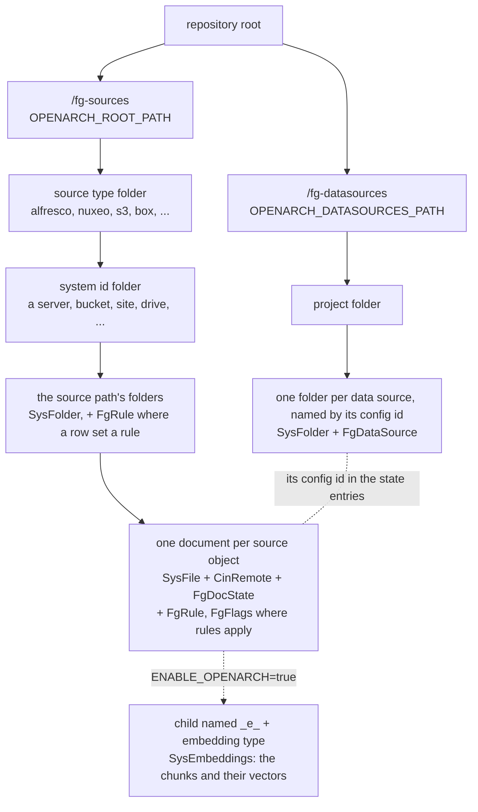
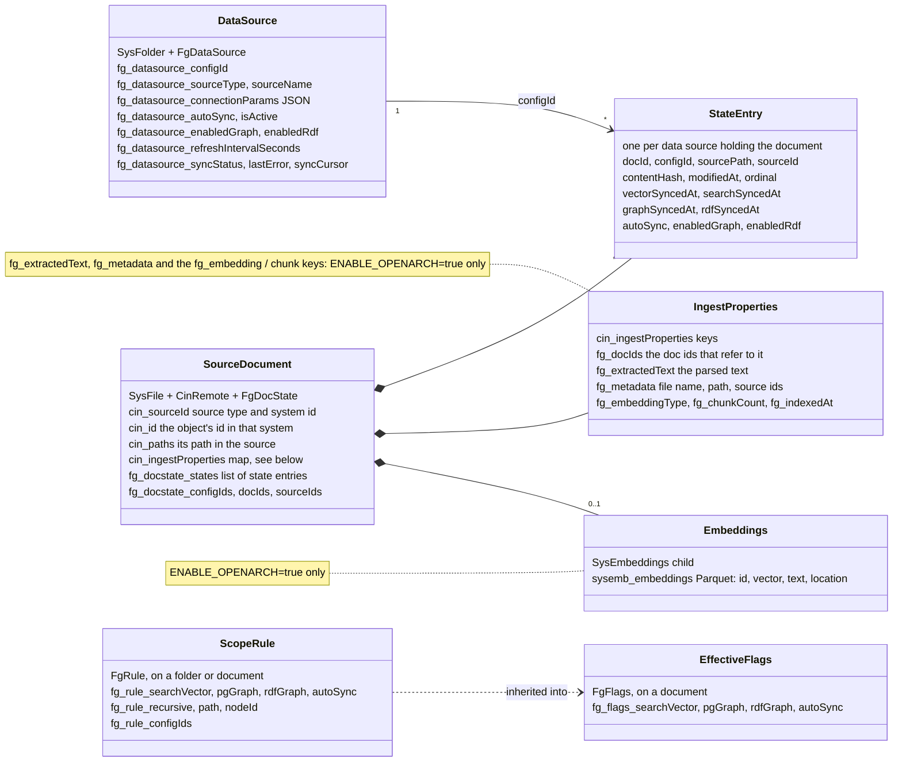

# OpenArch as the Auto-Sync State Store

[Incremental auto-sync](../../DATA-SOURCES/INCREMENTAL-UPDATE-AUTO-SYNC/README.md) keeps a registry: the data
sources it follows (`datasource_config`) and what it has ingested from each one (`document_state`). By default
that registry is two PostgreSQL tables. With `INCREMENTAL_STATE_STORE=openarch` it is kept in
[OpenArch](OPENARCH.md) instead, as documents in the OpenArch tree, and no PostgreSQL is needed.

The REST API, the MCP tools and the UIs work the same with either store. OpenArch adds **scope rules**: per-folder
and per-document choices of what Flexible GraphRAG does with them, kept on the objects themselves (see
[Scope rules](#scope-rules)).

This is independent of `ENABLE_OPENARCH`: the state can be in OpenArch while the vectors and search index are in
`VECTOR_DB` / `SEARCH_DB`, or both can be in OpenArch.

## Setup

1. Run OpenArch, as in [Hyland OpenArch](OPENARCH.md#running-openarch). Its client,
   python-openarch-api, comes with the backend.
2. In the backend's `.env`:

    ```bash
    ENABLE_INCREMENTAL_UPDATES=true
    INCREMENTAL_STATE_STORE=openarch
    OPENARCH_URL=http://localhost:8088
    OPENARCH_USERNAME=admin
    OPENARCH_PASSWORD=password
    #OPENARCH_DATASOURCES_PATH=/fg-datasources   # where the data sources go (default)
    #OPENARCH_ROOT_PATH=/fg-sources              # where the documents and their state go (default)
    ```

3. Restart the backend. On first start it adds its schemas to OpenArch's repository model: `fgdatasource`,
   `fgdocstate`, `fgrule` and `fgflags`. If OpenArch is not reachable, the backend says so in its log; start
   OpenArch, then restart the backend.

`POSTGRES_INCREMENTAL_URL` is not used. The state already in PostgreSQL is not moved to OpenArch: data sources
registered there stay there, so ingest them again after switching.

The CocoIndex pipeline (`PIPELINE_BACKEND=cocoindex`) keeps its state in PostgreSQL.

## Where the state goes

| What | Where in OpenArch | Fields |
|---|---|---|
| A data source (an ingest, or an auto sync) | a folder at `<OPENARCH_DATASOURCES_PATH>/<project>/<config id>`, titled with the data source's name | `fg_datasource_*` (mixin `FgDataSource`): source type, connection settings, refresh interval, auto sync, which graphs it builds, ... |
| What a data source ingested from a document | on the document itself, at `<OPENARCH_ROOT_PATH>/<source type>/<system id>/<source path>` | `fg_docstate_*` (mixin `FgDocState`): one entry per data source holding the document (when it was synced to each store, its content hash, auto sync, which graphs) |
| A scope rule | on the folder or document it is about, in the same tree | `fg_rule_*` (mixin `FgRule`) |
| The rules in effect for a document | on the document | `fg_flags_*` (mixin `FgFlags`), for queries |

A document's state lives on the same OpenArch document the [search + vector store](OPENARCH.md#where-documents-go)
writes, so with `ENABLE_OPENARCH=true` there is one OpenArch document per source document, holding its text,
chunks and state. Without it, the OpenArch document holds only the state.

Updates are conditional on the document's version and retried on a conflict, so concurrent syncs don't overwrite
each other's entries.

## Data model

The same OpenArch objects serve both settings. `INCREMENTAL_STATE_STORE=openarch` writes the data sources and each
document's state; `ENABLE_OPENARCH=true` adds the document's text and its chunks with their embeddings (dashed below).
With both on, one OpenArch document per source document holds all of it.

Where things are:



What each one holds:



The PostgreSQL state store keeps the same information in two tables: `datasource_config` (a data source) and
`document_state` (a state entry).

## Scope rules

A scope rule is set on one source object, a folder or a document, and says what Flexible GraphRAG does with it, one
flag at a time:

| Flag | Meaning |
|---|---|
| `searchVector` | in the search + vector index (OpenArch, or `VECTOR_DB` / `SEARCH_DB`) |
| `pgGraph` | in the property graph |
| `rdfGraph` | in the RDF graph |
| `autoSync` | its changes in the source are followed |

A flag a rule doesn't set is inherited: a document's flags come, one by one, from the nearest rule that sets
them, its own or its closest folder's. A folder's rule covers the documents below it at any depth when it is
recursive (the **Deep** checkbox), else only those directly in it. Setting a flag on a folder clears that flag on
the rules below it, since the change applies to the whole folder.

The Processing tab's per-row checkboxes (Search+Vector, Graph, RDF, Auto Sync) become rules on the rows' objects.
A plain ingest of a selection does the same for what it selects. So including a folder and excluding one of its
subfolders are two rules: the folder's flags on, the subfolder's off.

The auto syncs follow the rules:

- A filesystem, Alfresco or Nuxeo auto sync watches the top-most objects whose rules turn `autoSync` on for it,
  so turning a row's Auto Sync on or off only writes a rule.
- A new or changed document is ingested into the stores its flags allow, and left out of the others.
- `POST /api/sync/ingest-status` returns each row's rule flags as `flags` (`null` where no rule sets one), which
  the UIs use to show the rows' checkboxes.

Rules are matched by the objects' source ids where the source has them (Alfresco, Nuxeo), else by their source
paths, as the Processing tab's rows are. So a rule on an Alfresco or Nuxeo object still applies after the object
moves in the source system.

## Cleaning up

```bash
python scripts/cleanup.py --openarch
```

With `INCREMENTAL_STATE_STORE=openarch` this deletes the data sources and their state, along with what was ingested
into OpenArch (with `ENABLE_OPENARCH`).
