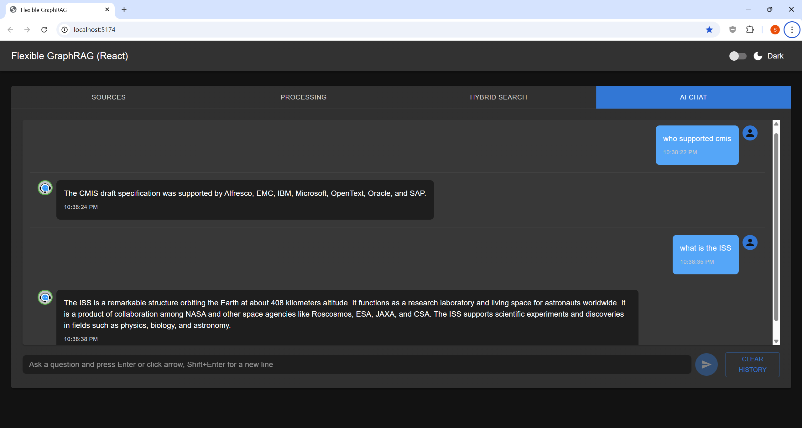

# Tab 4 — AI Chat

Conversational interface for iterative document Q&A.

- **Your questions** appear on the right; **AI answers** appear on the left
- Type your question and press **Enter** or click **Send**
- Each answer lists the documents it came from under **Sources:**; a name is a link when the
  document can be opened (ACA's viewer or Alfresco Share, Nuxeo Web UI, SharePoint / OneDrive,
  Box, Google Drive, GCS, and S3 / Azure Blob through short-lived signed URLs; see
  [Hybrid Search](UI-TAB-SEARCH.md#source-labels-in-results))
- The **Sources** chips above the input limit a question to chosen sources, and the header's
  **sign-in pill** makes answers use only documents you may read; see the
  [Sign-In and Permission-Aware Search guide](../DATA-SOURCES/SIGN-IN-GUIDE.md)
- Full conversation history is preserved in the session
- Click **"CLEAR HISTORY"** to start a new conversation
- **Best for**: Follow-up questions, iterative exploration, multi-turn reasoning
