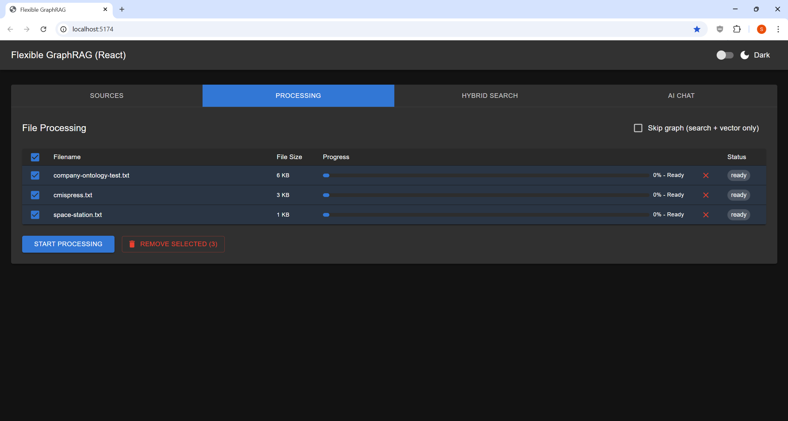
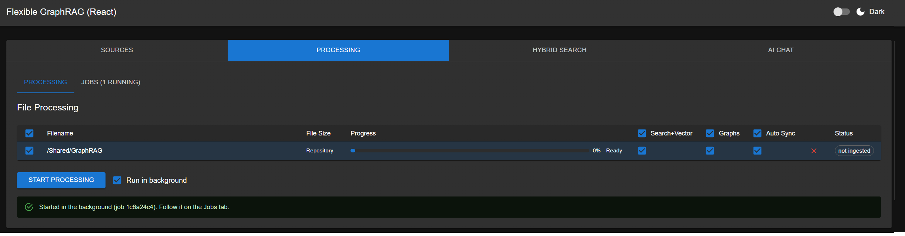
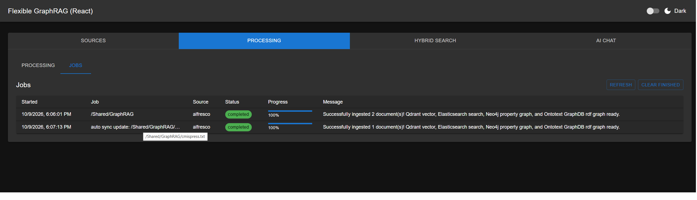
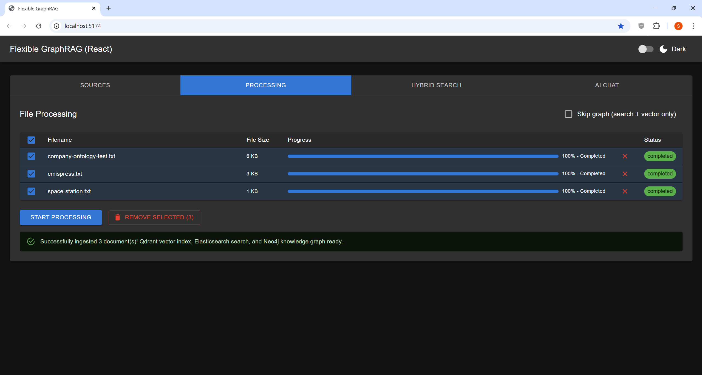
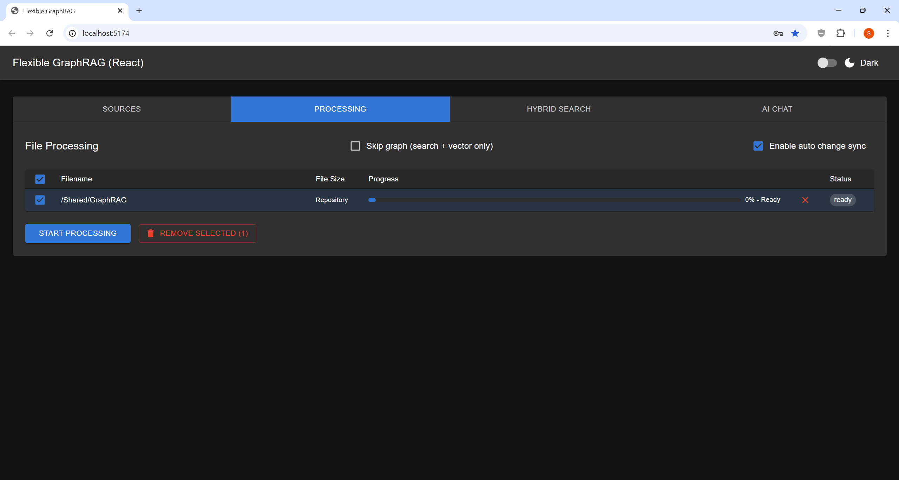

# Tab 2 — Processing

Process selected documents and monitor progress.

## Before Processing

Click **"START PROCESSING"** to begin. The button is visible once files or a data source are configured.



## Starting Processing

1. Tick **Auto Sync** on the rows to keep in sync (or, when the incremental registry is off,
   select **"Enable auto change sync"**) if you want automatic monitoring for file changes
   (supported sources only)
2. Click **"START PROCESSING"** to begin
3. Monitor real-time progress bars per file
4. The pipeline runs: document parsing → chunking → vector indexing → knowledge graph extraction → full-text indexing

## Processing Options

| Option | Description |
|---|---|
| **Document Parser** | Docling (local, free) or LlamaParse (cloud API) |
| **Skip Graph** | Skip knowledge graph extraction (vector + search only). Replaced by the per-row **Graph** / **RDF** columns (**Graphs** with an older backend) when those are shown (below) |
| **Enable auto change sync** | Turn on incremental update tracking for this source. Replaced by the per-row **Auto Sync** column when that is shown (below) |
| **Run in background** | Start the job and keep the tab free to start another; follow it on the **Jobs** sub-tab |

## Search+Vector and Graphs per Row (all data sources)

With the incremental system on (default or Langflow pipeline), the table gets checkbox columns
that say what each row should end up in, for every data source:

- **Search+Vector** — the vector and full-text search stores
- **Graph** and **RDF** — the property graph (`PG_GRAPH_DB`) and the RDF graph (`RDF_GRAPH_DB`),
  each on its own (needs Search+Vector). Each column is shown when that store is configured and
  `ENABLE_KNOWLEDGE_GRAPH` is on. With a backend older than v0.9.0 there is one **Graphs** column
  for both
- **Auto Sync** — kept up to date with source changes (needs Search+Vector). There is no Auto
  Sync column where no sync can watch the source: file uploads, CMIS, web, Wikipedia and YouTube

Alfresco, Nuxeo and file uploads get one row per document or folder. The other sources (S3, GCS,
Azure Blob, Box, Google Drive, OneDrive, SharePoint, CMIS, web, Wikipedia, YouTube) get **one row
for the whole datasource**: unticking Graph or RDF removes only that graph, unticking Search+Vector
removes all of it, ticking either back re-ingests, and Auto Sync on / off starts or stops its
auto sync (stopping keeps the documents).

**Deep:** the Alfresco, Nuxeo and Box source forms have a **Deep** checkbox — include subfolders
at every depth (recursive) in the ingest and its auto sync. It starts at the backend's
`DEFAULT_RECURSIVE` (true unless set; the UIs read it from `GET /api/ui-defaults`, v0.9.0+).

They start at what each row is in now (new rows: Search+Vector, and Graph / RDF as the backend's
`DEFAULT_ENABLED_GRAPH` / `DEFAULT_ENABLED_RDF` say, both true unless set), and the **Status**
column shows that: *search+vector, graphs* (with separate columns: *search+vector, graph, rdf*),
*search+vector*, *not ingested*, or *removed*, with
*(synced)* when an auto change sync holds it. A header checkbox sets a column for every row. A
column whose stores are set to `none` in `.env` is disabled.



Rows already in the stores start unchecked. Changing a row's Search+Vector or Graphs checks the
row; **START PROCESSING** then does, for each checked row:

| Search+Vector | Graphs | Row is in now | START PROCESSING |
|---|---|---|---|
| ☑ | ☑ | anything | ingest with graphs (a refresh if it is already there) |
| ☑ | ☐ | search+vector **and** graphs | remove the graphs only |
| ☑ | ☐ | search+vector only, or nothing | ingest without graphs (a refresh if already there) |
| ☐ | ☐ | anything | remove it from every store |

With separate **Graph** and **RDF** columns, each graph follows the Graphs column above on its
own: unticking only RDF on a row that has both graphs removes the RDF graph and keeps the
property graph, and ticking only Graph on a new row ingests it with the property graph and no
RDF graph.

All of it runs as one job. Afterwards the rows' choices go back to their defaults, so pressing
START again does not repeat the run. Removing never touches the repository; ingest again to put
a row back.

**With auto change sync**, a removal sticks: a document whose graphs were removed keeps leaving
the graph out of its sync updates, and a document removed from every store stays out of the
sync (its row shows *removed*) even when it changes in the repository — until you ingest it
again. Renames and moves are still recorded. Each graph is also a datasource setting: once none
of its documents is left in a graph, its auto sync stops building that graph, and an ingest that
builds it turns it back on.

### Auto Sync per Row

The **Auto Sync** column starts checked for rows an auto change sync follows. For each checked
row, START PROCESSING applies a change in it along with any store change:

- **Unchecked**: the sync stops for the row's documents — they stay in the stores as they are,
  and later repository changes leave them alone. If the row is one of the datasource's own roots
  (a node selected when the sync was set up, or its path), it also comes off the datasource's
  root list, so new files there are no longer picked up. Once a datasource has no roots left it
  stops syncing: it becomes an ingest-only record while some of its documents are still in a
  store (they can still be refreshed or removed here), and it is deleted once none is. So to
  remove an auto sync completely, uncheck Search+Vector (removes from every store) and Auto Sync
  on its rows.
- **Checked** on a row whose sync was stopped: it resumes (a root goes back on the list), and
  the row is ingested again, so edits made while its sync was off reach the stores right away. On a
  row no sync covers (say, two new documents, one checked): the run's datasource becomes an auto
  sync watching the checked rows, and the other rows ingested with them are recorded in it with
  their auto sync off — check them later to resume. It is all one job.

## Jobs Sub-tab

The Processing tab has two sub-tabs, **Processing** and **Jobs** (*Jobs (N running)* while some
run). Jobs lists the processing jobs — ones started here and auto sync runs — oldest first, with
start time, what was selected, source, status, progress and the full message (which names the
stores, e.g. *Removed 5 document(s) from Neo4j property graph and Ontotext GraphDB rdf graph.*).
Running ingest jobs can be cancelled; **Clear finished** removes finished ones from the list. The
backend keeps the list in memory until it restarts.



With **Run in background**, START returns at once and the Processing sub-tab is free; when the
job finishes, its per-file result and message are shown there like a foreground run. In KG
Spaces, leaving the page for elsewhere in ACA and coming back keeps the selection, the run and
its progress. KG Spaces for ACA and KG Spaces for Nuxeo start with **Run in background** ticked
(v0.9.0+; the Angular library's `runInBackground` option).

When a run finishes, the **Sources** chips on Hybrid Search and AI Chat are refreshed, so a
source the run added or emptied shows up or goes away (v0.9.0+).

## Processing Complete



## File Management

- Click a row's **✕** to take it off the list — not from your source system, and not from the stores (see **Remove** above)

## Auto-Sync Processing

When **Auto Sync** is ticked on a row (or **"Enable auto change sync"** is selected, with the
incremental registry off) before clicking **"START PROCESSING"**, the system continues monitoring the source for changes after the initial ingest completes.



## Processing Pipeline

```
Document → Parser (Docling/LlamaParse)
         → Chunks (SentenceSplitter)
         → Embeddings → Vector DB (Qdrant, etc.)
         → KG Extraction (LLM) → Graph DB (Neo4j, etc.)
         → BM25 / Elasticsearch indexing
```
