# Tab 1 — Sources

Configure your data source and select files for processing.

!!! note "Auto sync and sign-in"
    Where a section below says to select **"Enable auto change sync"**: with the incremental
    registry on, every data source instead gets per-row **Search+Vector** / **Graphs** / **Auto
    Sync** columns on the Processing tab; tick **Auto Sync** there (see
    [Tab 2 — Processing](UI-TAB-PROCESSING.md)). The Alfresco, Nuxeo and CMIS forms can also ingest
    with your header sign-in instead of typed credentials (see the
    [Sign-In guide](../DATA-SOURCES/SIGN-IN-GUIDE.md)).

## File Upload

Auto sync is not supported for the file upload UI.

1. Select **"File Upload"** from the data source dropdown
2. Drag & drop files onto the upload area, or click to open a file picker (multi-select supported)
3. Supported formats: PDF, DOCX, XLSX, PPTX, TXT, MD, HTML, CSV, PNG, JPG, and more
4. Click **"CONFIGURE PROCESSING"** to proceed

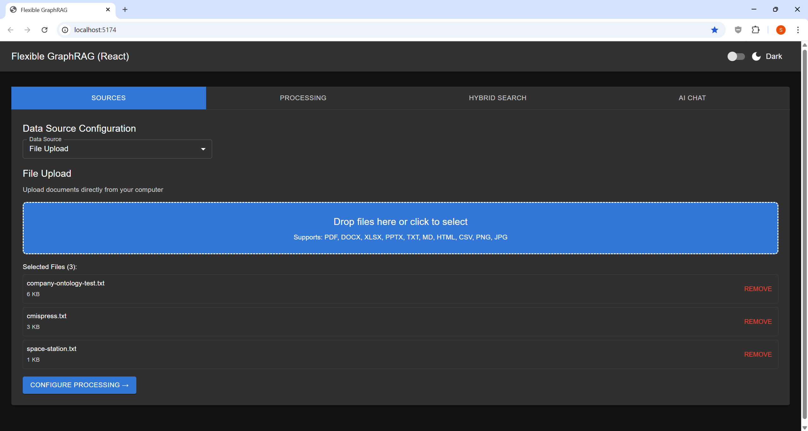

!!! note
    If you drag & drop new files after selecting via dialog, only the dragged files will be used.

!!! note "Local filesystem access"
    The web UIs upload files to the backend server. To index files and folders on your own disk with auto sync, use the [Desktop App](../GETTING-STARTED/DESKTOP-APP.md) (**Local Files and Folders**, below). To index files already on the server's filesystem, use the **MCP server** (`ingest_documents` with `filesystem` source) or the **REST API**.

## Local Files and Folders (desktop app)

Only in the [Desktop App](../GETTING-STARTED/DESKTOP-APP.md). Supports auto sync: a folder is watched and rescanned with its subfolders.

1. Select **"Local Files and Folders"** from the data source dropdown
2. Click **Browse...** and pick files and folders on the local disk (Ctrl / Shift for several), or add the folder you are in
3. The picks are listed in the form; remove one with its delete icon (**Leave out**), or all with **Clear**. Browse again to add more
4. Click **"CONFIGURE PROCESSING"** to proceed

## Browse...

In the web UIs and the desktop app, the **Alfresco, Nuxeo, CMIS, SharePoint, OneDrive, Box, Amazon S3, Azure Blob, Google Cloud Storage** and **Google Drive** forms have a **Browse...** button next to their path, folder or prefix field. It opens a file/folder browser of that source, so you pick a folder or documents instead of typing a path or an id.

- Fill in the form's connection fields first (URL, credentials or your sign-in, bucket / container / site); the button is enabled once they are complete. The browser uses the same settings the ingest will use, so it shows what the ingest can read.
- Open a folder to see what is in it (one level at a time), then select, or use the folder you are in.
- Each source type remembers the last folder you were in (in the browser's local storage).
- Starting an ingest clears the picks; the run's rows stay on the Processing tab.

What each source can pick:

| Source | Picks |
| --- | --- |
| Alfresco, Nuxeo | files and folders, several |
| Box, Google Drive, OneDrive | one folder, or several files |
| Amazon S3, Azure Blob, CMIS | one folder or one file |
| Google Cloud Storage, SharePoint | one folder |

Several picks show as chips under the field. The API behind it: `GET /api/browse` (the sources it supports) and `POST /api/browse` (one folder level, paged); see [REST API](../DEVELOPER/REST-API.md).

## Alfresco Repository

Supports auto sync — select **"Enable auto change sync"** on the Processing tab before clicking **"START PROCESSING"**.

- **Alfresco Base URL** — e.g. `http://localhost:8080/alfresco`
- **Authentication** — **basic**, **ticket** (enter username/password; the source self-fetches the ticket), or **OAuth2** (Bearer via the `identity-service` subsystem, e.g. Keycloak). See the [Alfresco Integration Guide](../DATA-SOURCES/README-alfresco.md).
- **Username / Password** (for basic / ticket)
- **Path** — e.g. `/Sites/example/documentLibrary`
- **Deep** — include subfolders at every depth (recursive) in the ingest and its auto sync

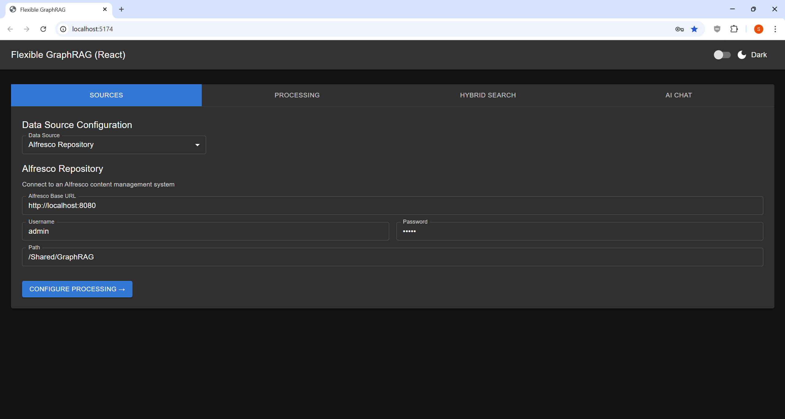

## Nuxeo Repository

Supports auto sync — select **"Enable auto change sync"** on the Processing tab before clicking **"START PROCESSING"** (real-time via the Nuxeo audit stream over Kafka).

- **Nuxeo URL** — e.g. `http://localhost:8081/nuxeo`
- **Authentication** — **basic**, **token** (enter username/password; the source self-fetches the token), or **OAuth2** (Bearer)
- **Path** — e.g. `/default-domain/workspaces/test`
- **Deep** — include subfolders at every depth (recursive) in the ingest and its auto sync

## CMIS Repository

Auto sync is not supported for this source.

- **CMIS Repository URL** — e.g. `http://localhost:8080/alfresco/api/-default-/public/cmis/versions/1.1/atom`
- **Username / Password**
- **Folder path** — e.g. `/Sites/example/documentLibrary`

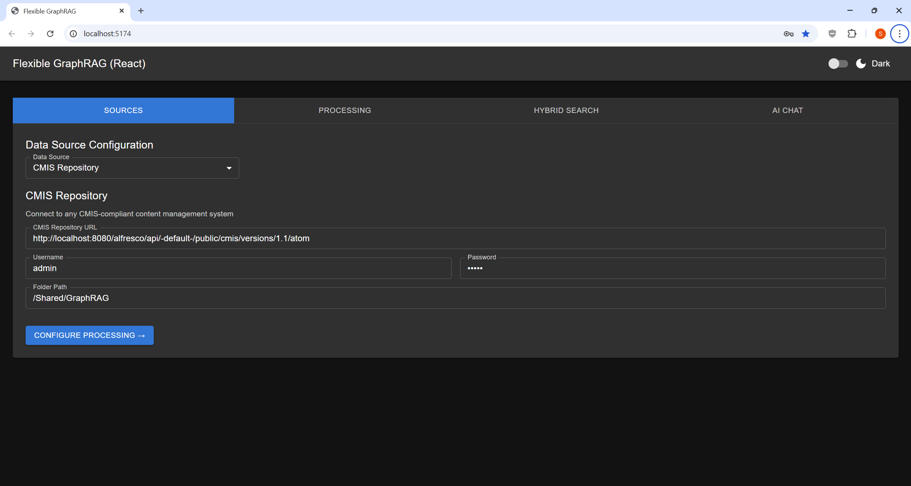

## Web Pages

Auto sync is not supported for this source.

- **URLs** — list of web page URLs to fetch and index

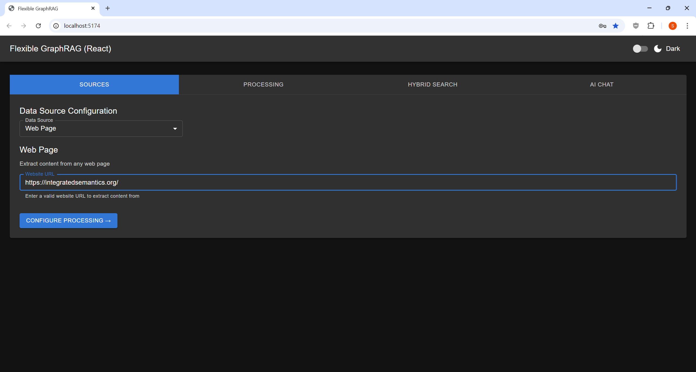

## Wikipedia

Auto sync is not supported for this source.

- **Titles** — list of Wikipedia article titles

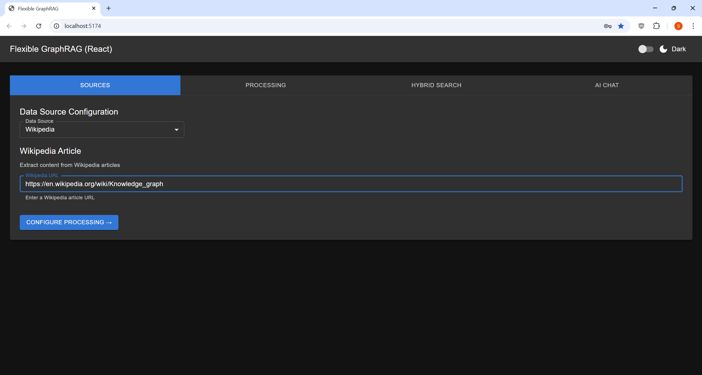

## YouTube

Auto sync is not supported for this source.

- **URLs** — list of YouTube video URLs (transcripts are indexed)

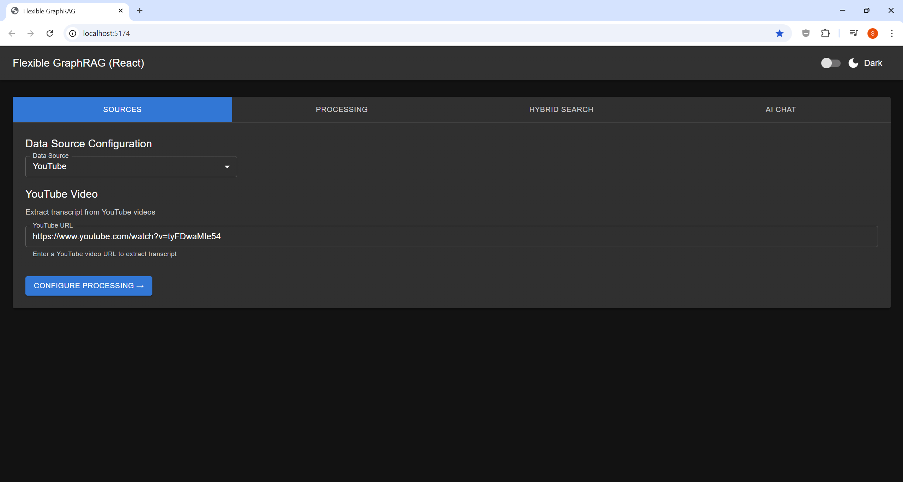

## Google Drive

Supports auto sync — select **"Enable auto change sync"** on the Processing tab before clicking **"START PROCESSING"**.

- **Credentials Path** — path to your service account JSON file
- **Folder ID** — Google Drive folder ID to index

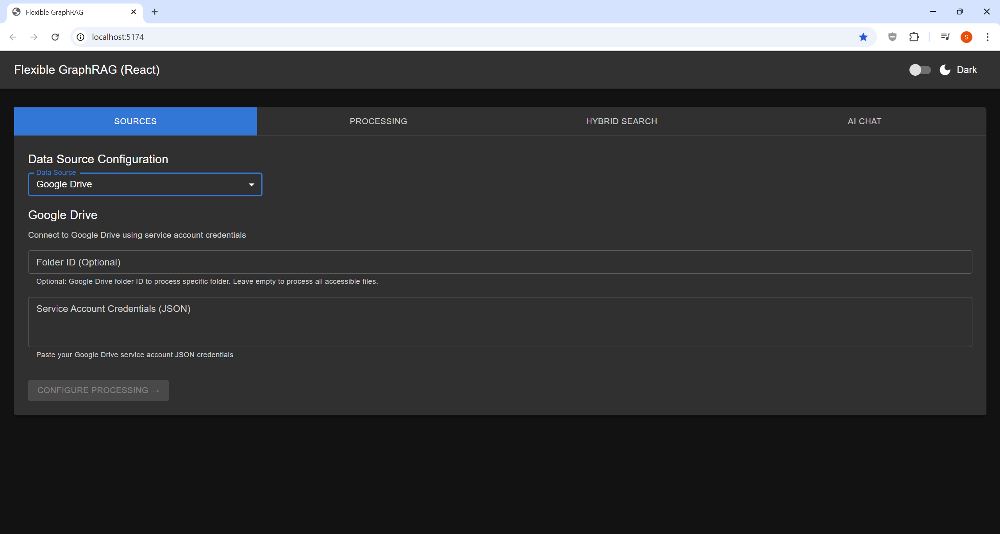

## Microsoft OneDrive

Supports auto sync — select **"Enable auto change sync"** on the Processing tab before clicking **"START PROCESSING"**.

- **Client ID / Client Secret / Tenant ID**

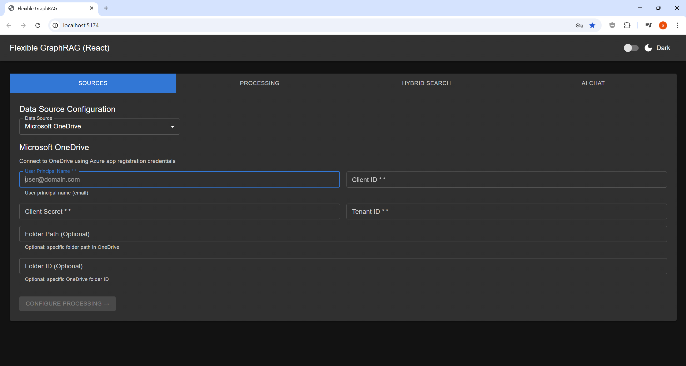

## Amazon S3

Supports auto sync — select **"Enable auto change sync"** on the Processing tab before clicking **"START PROCESSING"**. Also provide the **SQS Queue URL** in the source form.

- **Bucket** — S3 bucket name
- **AWS Access Key ID / Secret Access Key / Region**

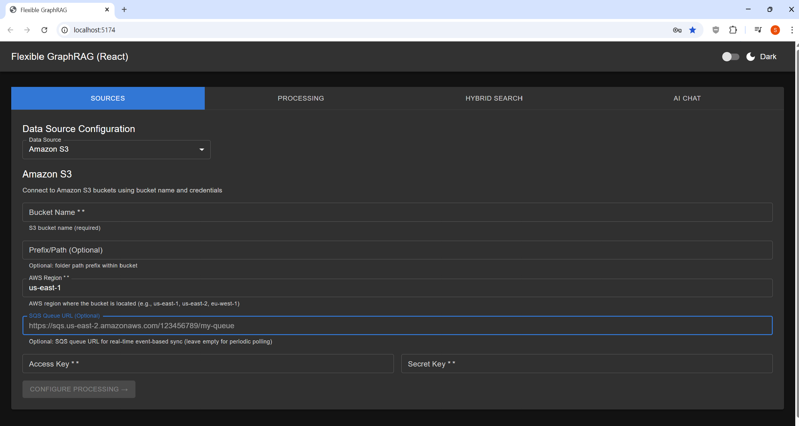

## Azure Blob Storage

Supports auto sync — select **"Enable auto change sync"** on the Processing tab before clicking **"START PROCESSING"**.

- **Connection String**
- **Container Name**

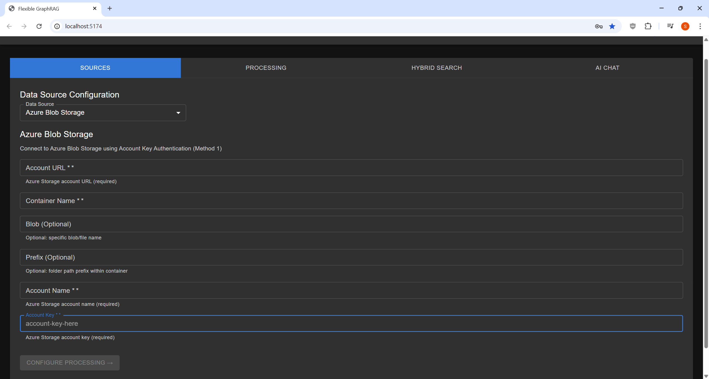

## Google Cloud Storage

Supports auto sync — select **"Enable auto change sync"** on the Processing tab before clicking **"START PROCESSING"**. Also provide the **Pub/Sub Subscription Name** in the source form.

- **Bucket Name**
- **Credentials Path** — path to your service account JSON file

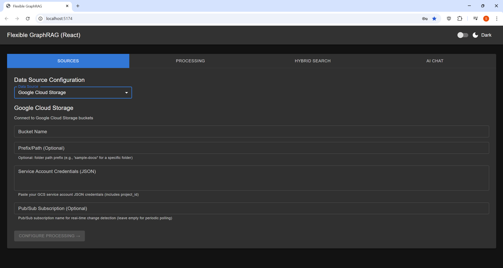

## Box

Supports auto sync — select **"Enable auto change sync"** on the Processing tab before clicking **"START PROCESSING"**.

- **Client ID / Client Secret**
- **Folder ID**
- **Deep** — include subfolders at every depth (recursive) in the ingest and its auto sync

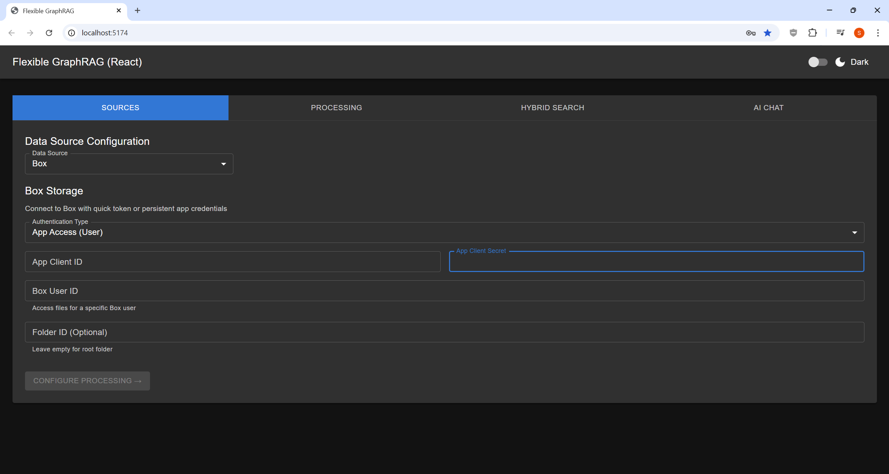

## SharePoint

Supports auto sync — select **"Enable auto change sync"** on the Processing tab before clicking **"START PROCESSING"**.

- **Client ID / Client Secret / Tenant ID**
- **Site URL**

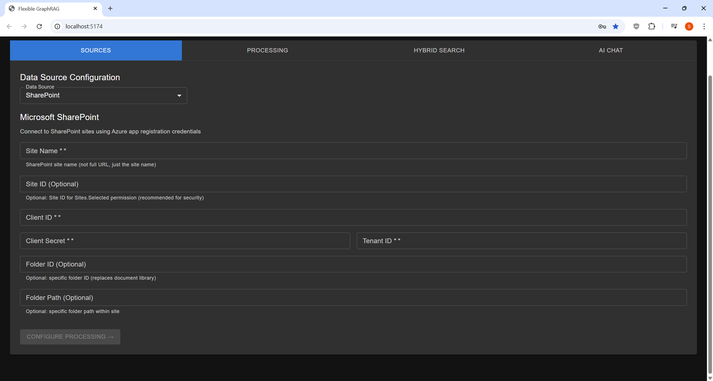

## All 14 Data Sources

| Category | Sources |
|---|---|
| File & Upload | File Upload, Local Files and Folders (desktop app) |
| Cloud Storage | Amazon S3, Google Cloud Storage, Azure Blob Storage, Google Drive, Microsoft OneDrive |
| Enterprise Repositories | Alfresco, Nuxeo, Microsoft SharePoint, Box, CMIS |
| Web Sources | Web Pages, Wikipedia, YouTube |

See [Data Sources](../DATA-SOURCES/OVERVIEW.md) for full configuration details for each source.

## Auto-Sync (Incremental Updates)

Select **"Enable auto change sync"** on the Processing tab **before clicking "START PROCESSING"** to automatically keep your databases synchronized when files change.

- S3: also provide the **SQS Queue URL**
- GCS: also provide the **Pub/Sub Subscription Name**

See [Incremental Auto-Sync](../DATA-SOURCES/INCREMENTAL-UPDATE-AUTO-SYNC/README.md) for setup details.
